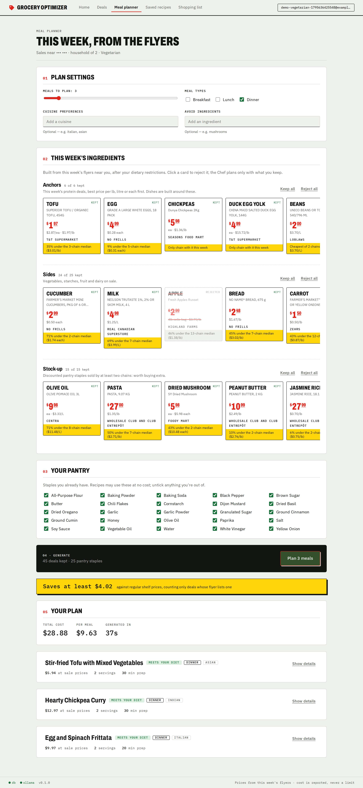

# Grocery Optimizer

**What can you cook from this week's grocery sales near you, within your
dietary restrictions?**

Grocery Optimizer reads the weekly flyers for every store around a postal code,
filters the deals through a deterministic dietary gate, sorts them into trays
for the user to review, and has LLM agents (a Chef that plans dishes and
SousChefs that write them) build recipes in which every ingredient cites a real
flyer deal.

**→ [Read the walkthrough](docs/walkthrough/README.md)** for the full tour:
sign-up, deals, trays, generation, the shopping list, the database underneath
and how the system is evaluated. No install needed.

## Highlights

- **Dietary compliance is a lookup, not a judgement.** Curated product
  attributes decide every deal and recipe; no model, keyword or substring ever
  grants or denies access. Unsupported diets are refused, not guessed.
- **Citations everywhere.** Every recipe ingredient cites a `deal_id` or a
  pantry `product_id`. That one rule drives costing, the shopping list and
  the compliance check.
- **Code-built trays.** Cross-store price comparison picks what the LLM
  sees. That design came out of experiments showing order bias in long deal
  lists, even on 70B models, and it lets a local 7B model plan well.
- **Measured.** 1,584 deterministic tests, plus a record-and-replay evaluation
  harness over frozen data snapshots. Its compliance gate passes in 14 of 14
  of the latest live runs.

## Stack

FastAPI · PostgreSQL (Neon) · React + TypeScript (Vite) · Ollama
(`qwen2.5:7b`) and Hugging Face router (`gpt-oss-120b` labeller) · MLflow
tracing · Playwright (walkthrough capture)

## Running it

See [SETUP.md](SETUP.md). [ROADMAP.md](ROADMAP.md) has the plan and the
shipped log.
