# Grocery Optimizer: a walkthrough

> **What can you cook from this week's grocery sales near you, within your
> dietary restrictions?**

Grocery Optimizer reads the weekly flyers for every store around a postal code,
sorts the deals a user is allowed to eat into "trays", lets them review those
trays, and then has a small team of LLM agents plan and write recipes around
what they kept. Every ingredient in every recipe points back to one real flyer
deal or one pantry staple. Dietary compliance is a database lookup, never a
model's opinion.

Every screenshot below was captured headlessly on **real flyer data from the
week of 2026-11-23** by [`frontend/scripts/walkthrough.mjs`](../../frontend/scripts/walkthrough.mjs).
It registers a fresh vegetarian profile, walks the planner end to end and
generates a live meal plan on a local 7B model. The postal code is redacted in
every frame: the script refuses to save a screenshot if the raw code is still
anywhere in the page.

**Contents:**
[1 · Sign up](#1--sign-up-where-you-shop-and-what-you-cant-eat) ·
[2 · Deals](#2--the-deals-already-filtered) ·
[3 · Trays](#3--trays-this-weeks-ingredients-sorted-and-compared) ·
[4 · Generation](#4--generation-chef-souschefs-and-a-lookup-table) ·
[5 · Shopping list](#5--the-shopping-list) ·
[6 · The data underneath](#6--the-data-underneath) ·
[7 · How it's evaluated](#7--how-its-evaluated)

---

## 1 · Sign up: where you shop, and what you can't eat

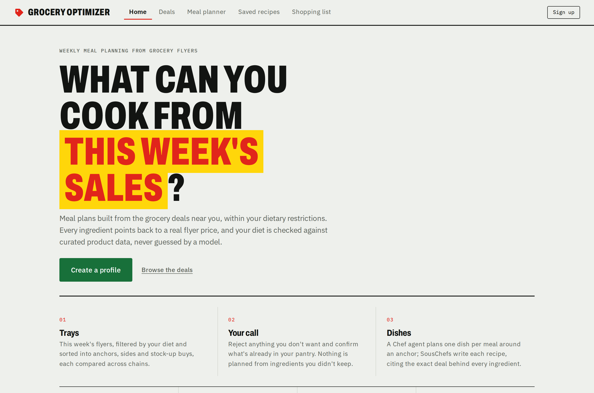

A profile is a postal code, a household size and a set of dietary
restrictions.

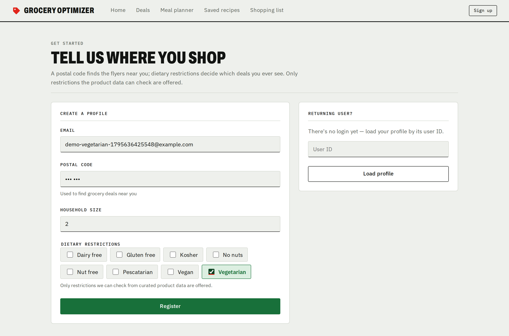

The restriction picker is not free text. It offers only the restrictions the
backend can **check from curated product data**: vegetarian, vegan,
pescatarian, dairy-free, gluten-free, nut-free and kosher. Each one maps to
boolean attributes on the `products` table (`contains_meat`, `contains_fish`,
`contains_dairy`, `contains_egg`, `contains_nuts`, `contains_gluten`,
`contains_animal_byproduct`, `not_kosher`). Kosher also adds a rule that no
single product can break, "no meat with dairy", which is checked over the
whole recipe.

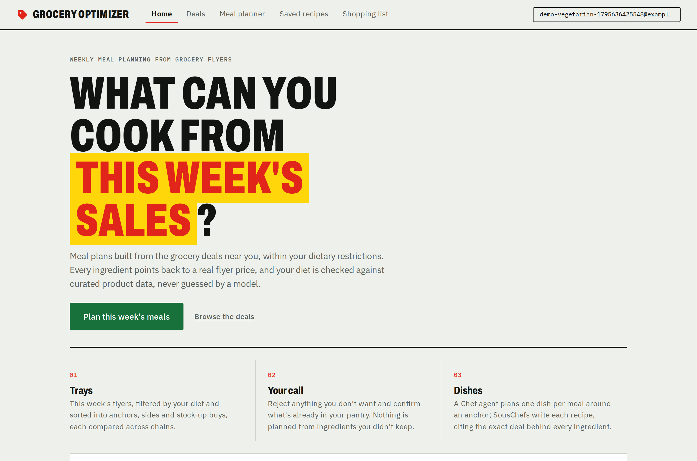

## 2 · The deals, already filtered

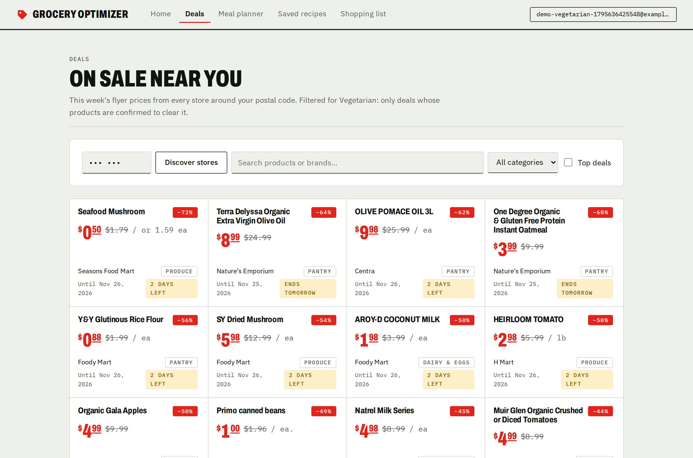

The deals page is the raw material: this week's flyer prices from every store
near the user. For a restricted user it goes through the **same SQL gate as
the planner** (`app/services/deal_gate.py`). A deal is served only if every
product linked to it is *confirmed* and clears every restriction. Unlinked or
unreviewed products withhold the deal; NULL attributes fail closed.

Notice **"Seafood Mushroom"** at the top of a vegetarian's list. It is a
mushroom, and its curated product says so. No name, keyword or substring ever
grants or denies a deal on dietary grounds. Name matching both drops safe food
("Beefsteak Tomatoes" for a vegetarian, "Peanut Butter" for a vegan) and misses
unsafe food ("prosciutto", "marzipan"), so the project bans it outright.

## 3 · Trays: this week's ingredients, sorted and compared

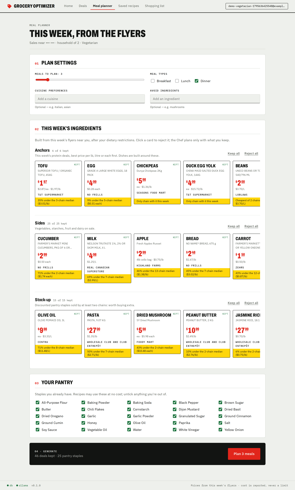

The planner doesn't hand the LLM a list of 900 deals. Code builds three
**trays** from the gated deal set (`app/services/trays.py`):

- **Anchors** are the protein deals that dishes are built around, ranked by
  price per lb, litre or each.
- **Sides** are vegetables, starches, fruit and dairy, with a quota per role so
  one category can't crowd out the rest.
- **Stock-up** is discounted pantry staples sold by at least two chains.

The yellow strip on each card is a **cross-store comparison**: the deal against
the median price of the same item at other chains ("35% under the 3-chain
median"). Package-priced items whose sizes differ get no gap claim.

The `item` and `role` labels come from a labelling job: `gpt-oss-120b` labels
each deal once after ingestion and stores the result in `deal_labels`. Those
labels decide only what is *surfaced* and how it is grouped. They never touch
dietary access, which was already settled by the gate.

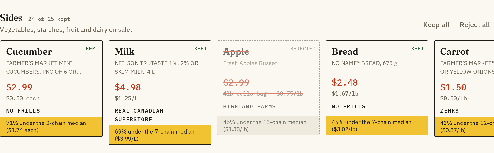

The user reviews the trays: click a card to reject it (the struck-through
apples above). Then they untick any pantry staples they're out of. The server
re-validates the kept ids against its own trays, so a client can't sneak in a
deal it was never offered.

> **Why trays?** The first version handed the Chef agent a long JSON list of
> deals. Two experiments showed that was hopeless.
>
> - **The model only saw the end of the list.** At the model's 8k context
>   window, Ollama kept only the last ~4k tokens of the prompt. The Chef never
>   saw its own instructions or the first 65 deals, and all 12 of its picks
>   came from deals 66–97.
> - **Order bias, even on a 70B model.** Measured over 3 shuffled seeds and 4
>   models, only 22% of a full list's picks came from outside its first fifth
>   (Llama-3.3-70B). Category browsing raised that to 76–80%, and code-built
>   trays to 79–84% on every model.
>
> Trays made the **local 7B model viable**: 3/3 valid, sensible plans. See
> [`experiments/chef/RESULTS.md`](../../experiments/chef/RESULTS.md).

## 4 · Generation: Chef, SousChefs and a lookup table

Generation runs as a background job; the UI follows the server's real pipeline
stage while it runs.

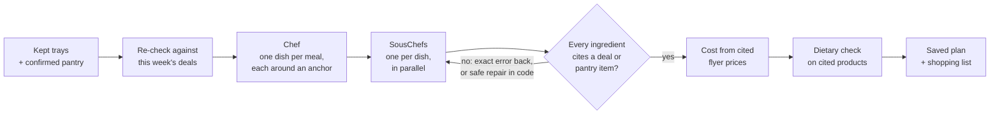

1. **Re-check** the kept ingredients against this week's deals.
2. **Chef** (dish planner) picks one dish per meal, each built around a kept
   anchor. An anchor may serve more than one dish. A plan that cites an id it
   was never shown is repaired or dropped in code.
3. **SousChefs** write each dish's recipe in parallel. Every ingredient must
   cite a `deal_id` from the dish's trays or a pantry `product_id`. Steps
   reference ingredients by placeholder (`"Heat {2} in a pan"`), and code
   renders them with each product's curated name. Output that fails validation
   gets the *exact* error back on retry. Safe problems, such as an uncited
   garnish and its placeholders, are repaired in code rather than thrown away.
4. **Costing** comes from the cited deals' flyer prices. Cost is reported,
   never a constraint: the product is budget-agnostic by design.

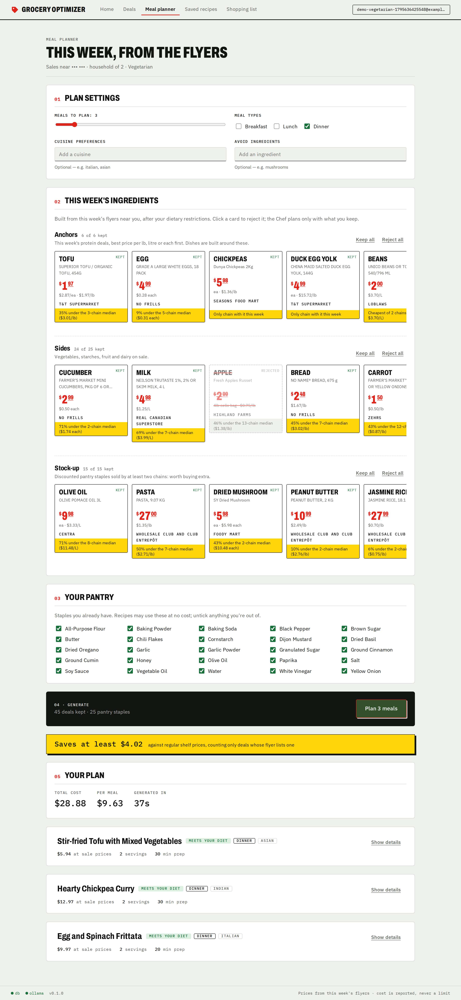

This plan took **37 seconds** on `qwen2.5:7b` running locally under Ollama:
three vegetarian dinners built around tofu, eggs and chickpeas. The savings
banner shows a floor, "at least $4.02", because most flyer deals don't print a
regular price. Savings degrade to *absent*, never to a made-up number.

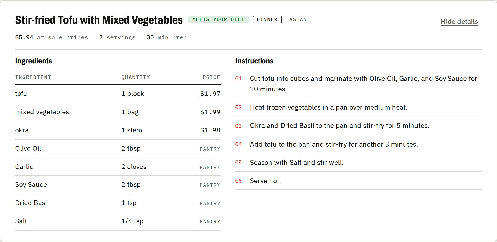

The recipe detail shows the citation model directly. Deal-backed ingredients
carry a flyer price; pantry staples say **PANTRY** and cost nothing, because
the user confirmed they already have them.

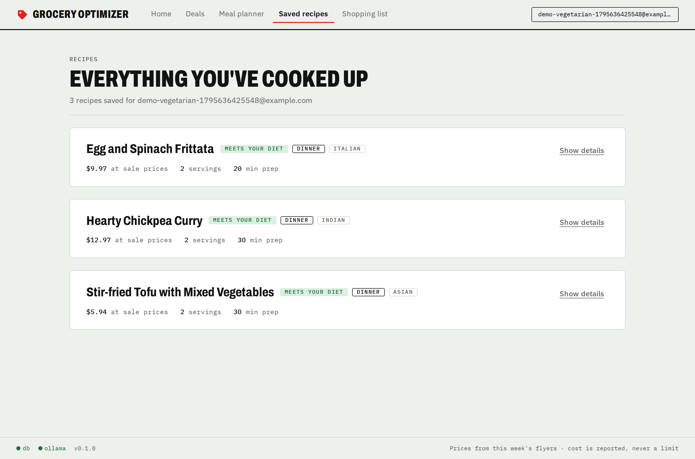

## 5 · The shopping list

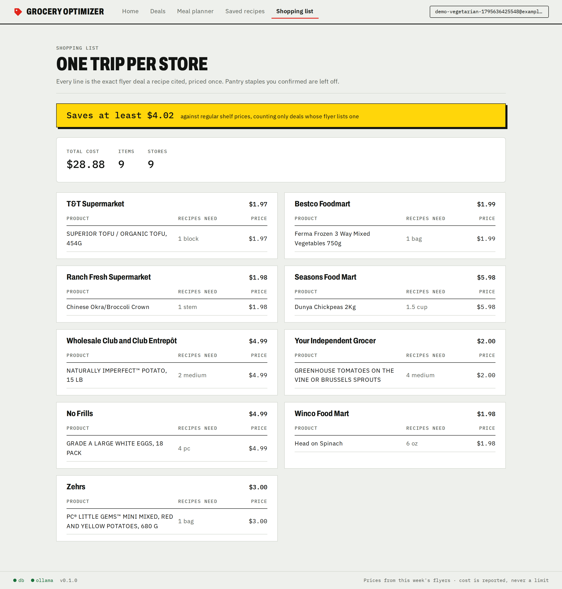

The shopping list is built from the citations, not by fuzzy-matching
ingredient names to products. Each line is one purchase of the exact deal a
recipe cited, grouped by store. "Recipes need" is the amount the dishes call
for, not a package count. A deal that several dishes share appears once.

## 6 · The data underneath

Everything runs on PostgreSQL (Neon), with 24 numbered migrations recorded in
`schema_migrations`. The core of the schema:

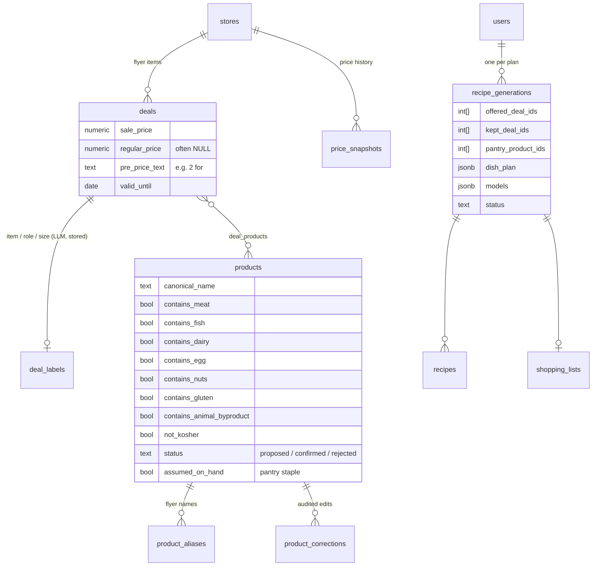

How a flyer becomes data the planner can trust:

1. **Ingestion** (`app/services/flipp_ingestion.py`) pulls flyer items for a
   postal code into `stores` and `deals`, and appends each price to
   `price_snapshots`. That table is a native PostgreSQL partitioned table
   (monthly partitions), deliberately kept as long-run price history; nothing
   prunes it. The current data: 87 stores, 1,249 deals, 1,365 price snapshots.
2. **Product linking.** Flyer names are proposed as products, reviewed, and
   linked through `product_aliases` / `deal_products`. Attributes are set by
   review, with owner rules such as "rennet cheeses count as meat" and "honey
   is an animal by-product". Every change is recorded as an auditable row in
   `product_corrections` (380 so far). 313
   curated products currently cover 644 of the 916 live deals.
3. **Labelling** stores one `deal_labels` row per deal: the item, the tray
   role and the package size. That's 916 rows, all produced by labeller prompt
   v6.
4. **Every generation is auditable.** `recipe_generations` records what was
   offered, what the user kept, the dish plan, the models, and failures too.
   An MLflow trace links each run's prompts and outputs.

## 7 · How it's evaluated

The regression oracle is **1,584 deterministic tests** with no network and no
live LLM (`pytest -m "not llm"`). Model quality is measured separately by an
evaluation harness (`app/eval/`):

- **Frozen snapshots.** A snapshot captures the deals, products, attributes and
  labels for one postal code on one date, with a content hash. Every run
  records the hash it ran against, and scoring refuses a mismatch.
- **Record, then replay.** A live run records every LLM call. Replays are
  deterministic, so the scorers can change without re-running
  any model.
- **Scorers are pure functions** of (run artifact, snapshot):
  - *structural*: did every requested dish survive?
  - *citations*: does every ingredient cite a deal this user was actually
    offered?
  - *compliance*: the hard gate, recomputed from snapshot attributes with the
    production code and never trusting the run's own verdict.
  - *cost* (lower bound, reported only), *on-sale share*, *diversity*
    (ingredient Jaccard between dishes), and *latency/tokens*.
- **Verdict.** A partial plan is a FAIL. Over-budget is reported, never gated.

The latest live re-baseline, 2026-11-25: 7 dietary archetypes × 2 runs, all on
the local `qwen2.5:7b`:

| | result |
|---|---|
| Runs | 14 |
| **Compliance gate** | **14 / 14 PASS** |
| Citation validity | 100% in every run |
| Overall verdict | 12 PASS / 2 FAIL |
| The 2 FAILs | both kosher: 2 of 3 dishes, the planner sometimes anchors a dish on an id it was never shown |
| LLM time | 29–211 s per plan (3–7 meals) |

The table traces two days of work. On 2026-11-23 the first live set scored
4 PASS / 1 FAIL. On 2026-11-24 it was 12 / 2 after product linking, and then
13 / 1 once the SousChef's output was repaired in code rather than discarded.

---

**Re-capturing these screenshots** (API on :8000, Vite on :3000):

```bash
cd frontend
DEMO_POSTAL=<postal code with ingested deals> node scripts/walkthrough.mjs --diet vegetarian --meals 3
```
